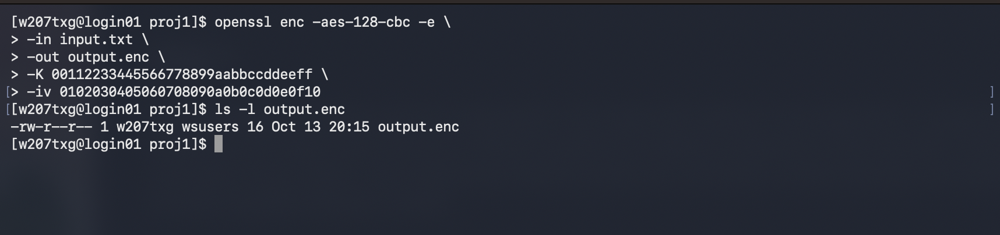
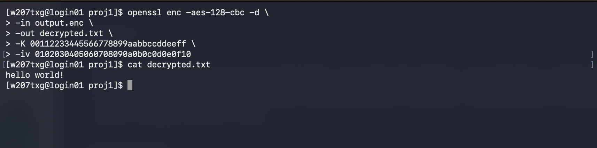
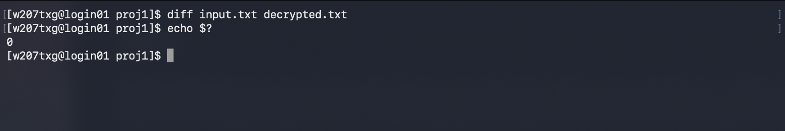
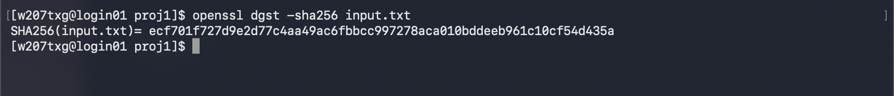
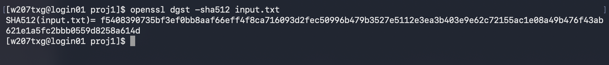
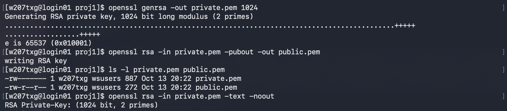

# Project 1 - Using Cryptographic Tools (80 Points)

## Task - 1

**Task Description:** Encrypt `input.txt` using AES in cbc mode with 128 bits. The output file is `output.enc`.  Please specify the encryption key and the IV. Please include the complete screenshot of the execution result of the command in your report. The screenshots should include your username, current directory, the `openssl` command, and the complete execution results.

**_Encryption Key:_** 00112233445566778899aabbccddeeff

**_IV:_** 0102030405060708090a0b0c0d0e0f10

{width=95%}

### Command Breakdown

| Part              | Meaning                              |
| ----------------- | ------------------------------------ |
| `openssl`         | Starts the OpenSSL tool              |
| `enc`             | Encryption/decryption utility        |
| `-aes-128-cbc`    | AES with a 128-bit key in CBC mode   |
| `-e`              | Encrypt                              |
| `-in input.txt`   | Original plaintext                   |
| `-out output.enc` | Encrypted output                     |
| `-K`              | Encryption key in hexadecimal        |
| `-iv`             | Initialization vector in hexadecimal |

### Discussion

I used `openssl` to encrypt `input.txt` using AES128 in CBC mode. I used a 128 bit encryption key and IV to encrypt the file. The encrypted data was saved in a new file called `output.enc`. I used the `ls -l` command to check that the file was created successfully.

\newpage

## Task-2

**Task Description:** Decrypt `output.enc` and name the output file as `decrypted.txt`. Please include the complete screenshots of the execution results of the commands in your report. The screenshot should include your username, current directory, the `openssl` commands,  and the complete execution results.  

{width=95%}

### Command Breakdown

| Part                 | Meaning                              |
| -------------------- | ------------------------------------ |
| `openssl`            | Starts the OpenSSL tool              |
| `enc`                | Encryption/decryption utility        |
| `-aes-128-cbc`       | AES with a 128-bit key in CBC mode   |
| `-d`                 | Decrypt                              |
| `-in output.enc`     | Encrypted file created in task 1     |
| `-out decrypted.txt` | Decrypted output                     |
| `-K`                 | decryption key in hexadecimal        |
| `-iv`                | Initialization vector in hexadecimal |

### Discussion

I used `openssl` to decrypt the `output.enc` file from Task 1. I used the same encryption key and IV to decrypt the file. The decrypted data was saved in a new file called `decrypted.txt`. This allowed me to recover the original text from `input.txt`.

\newpage

## Task-3 

**Task Description:** Use `diff` to verify the decrypted file is identical as the original plaintext file under the linux environment. The command format is as follows: 
`diff input.txt decrypted.txt` The output should be empty when the two files are identical. Again, please include the complete screenshots of the execution result of the command in your report.

{width=95%}

### Discussion

I used the `diff` command to compare the original `input.txt` file with the `decrypted.txt` file from Task 2. The command returned no output, meaning the two files were identical. This confirmed that the decryption was successful.

## Task-4

**Task Description:** Using `openssl` to generate the cryptographic hash of the input file using SHA256. Please include the complete screenshot of the execution result of the command in your report. The screenshots should include your username, current directory, the command, and the complete execution results.  

{width=95%}

### Discussion

I used `openssl` to generate a SHA256 hash of the `input.txt` file. The command created a 256 bit hash based on the contents of the file. The hash was displayed to the terminal.

## Task-5: 

**Task Description:** Using `openssl` to generate the cryptographic hash of the input file using SHA512. Please include the complete screenshot of the execution result of the command in your report. The screenshot should include your username, current directory, the command, and the complete execution results.  

{width=95%}

### Discussion

I used `openssl` to generate a SHA512 hash of the `input.txt` file. The command created a 512 bit hash based on the contents of the file. The hash was longer than the SHA256 hash generated in Task 4.

\newpage

## Task-6: 

**Task Description:** Using `openssl` to generate a pair of RSA public and private key pair with 1024 bits. Please include the complete screenshot of the execution result of the command in your report. The screenshots should include your username, current directory, and the complete execution results. 

{width=95%}

### Discussion

I used `openssl` to generate a 1024 bit RSA private key. I then used the private key to generate the corresponding public key. Both keys were saved in separate files called `private.pem` and `public.pem`.
