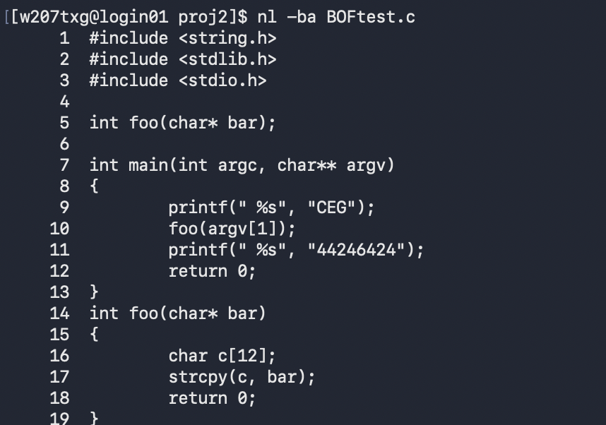
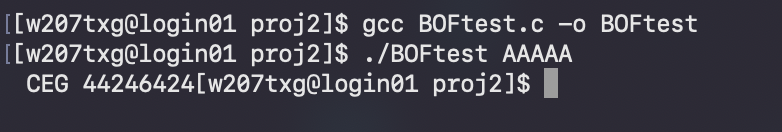
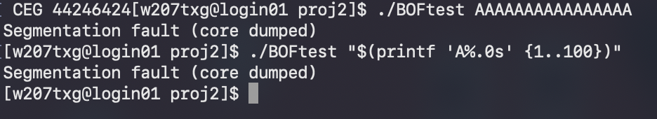
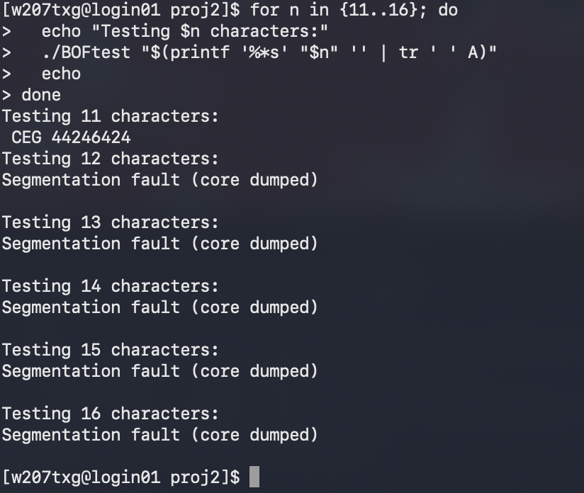
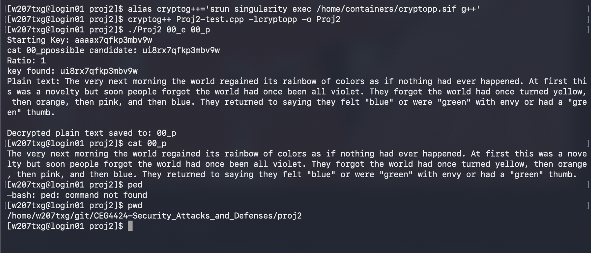
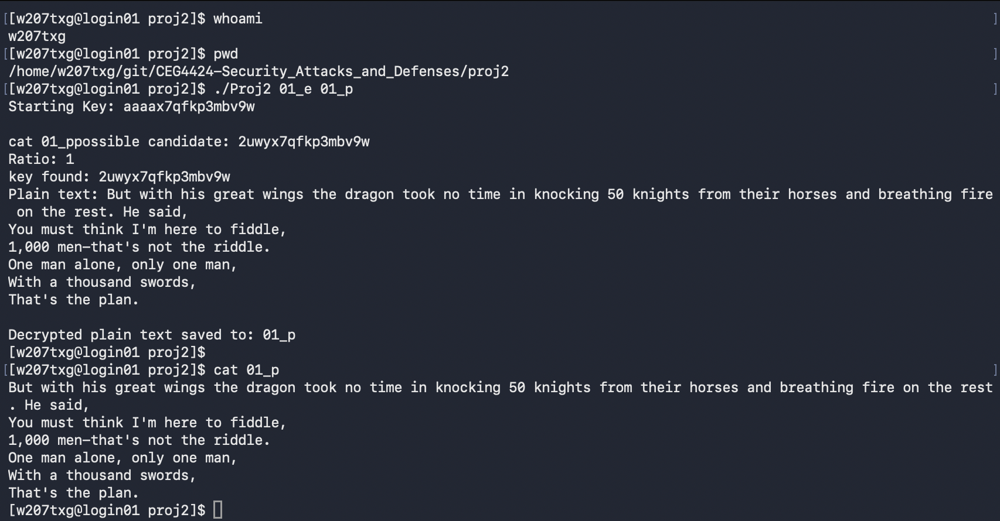
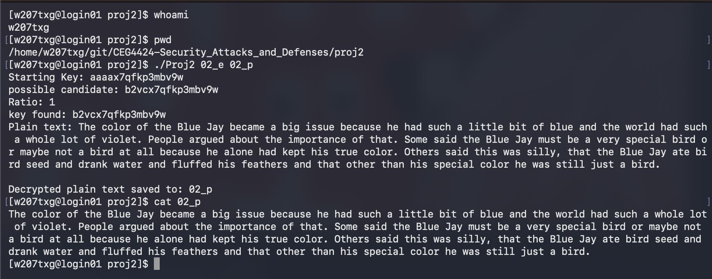

# Project 2 - Buffer Overflow and Exhaustive Key Search (90 Points)

## Task - 1

**Task Description:** The `BOFtest.c` is a source C code program. Use a text editor to examine the C source code file without changing it.



**Which line of code is the source of the buffer overflow vulnerability?**

Line 17: `strcpy(c, bar);`

**Which variable is subject to overflow?**

The variable `c`, declared on line 16 as `char c[12];`.

### Discussion

I examined the `BOFtest.c` source code and found that line 17, `strcpy(c, bar);`, causes the buffer overflow vulnerability. The `strcpy()` function copies data into the character array without checking its size. The variable `c` is declared with a size of 12 bytes, meaning it can safely hold 11 characters and the null terminator. If the input exceeds this size, it can overwrite memory outside the array.

\newpage

## Task - 2

**Task Description:** Compile `BOFtest.c` using the command `gcc BOFtest.c -o BOFtest`. Explain what this command does. Run the program with different numbers of input characters and determine when an error occurs. Include screenshots showing successful execution and the error.

**Compilation Command:** `gcc BOFtest.c -o BOFtest`

**Number of input characters when the error first occurred:** 12







### Command Breakdown

| Part | Meaning |
| --- | --- |
| `gcc` | GNU C compiler |
| `BOFtest.c` | C source code being compiled |
| `-o` | Specifies the output filename |
| `BOFtest` | Name of the executable program |
| `./BOFtest` | Executes the compiled program |
| `printf` | Generates input characters for testing |

### Execution Results

| Input Characters | Result |
| --- | --- |
| 5 | Successful execution |
| 11 | Successful execution |
| 12 | Segmentation fault |
| 13 | Segmentation fault |
| 14 | Segmentation fault |
| 15 | Segmentation fault |
| 16 | Segmentation fault |
| 100 | Segmentation fault |

### Discussion

I used the `gcc` command to compile `BOFtest.c` into an executable named `BOFtest`. I then ran the program with different numbers of input characters to determine when a buffer overflow occurred. The program executed successfully with 5 and 11 characters, but when I entered 12 characters, it resulted in a segmentation fault. The same error occurred with longer inputs.

This happened because the character array `c` only has 12 bytes of space. Since C strings require an additional byte for the null terminator, the maximum safe input is 11 characters. When 12 characters are entered, `strcpy()` attempts to copy 13 bytes into the array. This causes a buffer overflow, which resulted in the segmentation fault.

\newpage

## Task - 3

**Task Description:** The `Proj2-test.cpp` is a source C++ code program that uses the Crypto++ library. Examine the source code without modifying it and explain the functionality of the program in a short paragraph.

### Discussion

I examined the `Proj2-test.cpp` source code and found that it uses the Crypto++ library to perform an exhaustive key search on AES-encrypted data. The program starts with an initial encryption key and uses four nested loops to test different combinations of the first four characters. It attempts to decrypt the encrypted file using each key combination and checks whether the decrypted text contains valid ASCII characters. When it finds a key that produces ASCII text, it displays the key and decrypted message. The decrypted text is then saved to an output file. This demonstrates how brute-force attacks can be used to recover encrypted information when part of the encryption key is unknown.

\newpage

## Task - 4

**Task Description:** Compile `Proj2-test.cpp` using the Crypto++ library and execute the program with the encrypted files `00_e`, `01_e`, and `02_e`. Display the decrypted output using the `cat` command. Include screenshots showing the username, current directory, execution commands, and complete results.

**Compilation Commands:**

`alias cryptog++='srun singularity exec /home/containers/cryptopp.sif g++'`

`cryptog++ Proj2-test.cpp -lcryptopp -o Proj2`

### Command Breakdown

| Part | Meaning |
| --- | --- |
| `alias cryptog++` | Creates a shortcut for the compiler |
| `srun singularity exec` | Runs the compiler inside the provided container environment |
| `g++` | C++ compiler |
| `Proj2-test.cpp` | C++ source code |
| `-lcryptopp` | Links the Crypto++ library |
| `-o Proj2` | Creates an executable named `Proj2` |
| `./Proj2` | Executes the program |
| `00_e`, `01_e`, `02_e` | Encrypted input files |
| `00_p`, `01_p`, `02_p` | Decrypted output files |
| `cat` | Displays the contents of an output file |

### Execution 1 - File `00_e`



**Commands:**

`./Proj2 00_e 00_p`

`cat 00_p`

**Key Found:** `ui8rx7qfkp3mbv9w`

**Output:**

```
The very next morning the world regained its rainbow of colors as if nothing had ever happened. At first this was a novelty but soon people forgot the world had once been all violet. They forgot the world had once turned yellow, then orange, then pink, and then blue. They returned to saying they felt "blue" or were "green" with envy or had a "green" thumb".
```

### Discussion

I executed the `Proj2` program using `00_e` as the encrypted input file and `00_p` as the output file. The program tested different encryption keys until it found a key that produced readable text. The decrypted message was saved to `00_p`, and I used the `cat` command to display its contents.

\newpage

### Execution 2 - File `01_e`



**Commands:**

`./Proj2 01_e 01_p`

`cat 01_p`

**Key Found:** `2uwyx7qfkp3mbv9w`

**Output:**

```
But with his great wings the dragon took no time in knocking 50 knights from their horses and breathing fire on the rest. He said,

You must think I'm here to fiddle,

1,000 men—that's not the riddle.

One man alone, only one man,

With a thousand swords,

That's the plan.
```

### Discussion

I executed the program using `01_e` as the encrypted input file and `01_p` as the output file. The program found a different encryption key and displayed the decrypted message. I used `cat 01_p` to verify that the decrypted text was successfully saved to the output file.

\newpage

### Execution 3 - File `02_e`



**Commands:**

`./Proj2 02_e 02_p`

`cat 02_p`

**Key Found:** `b2vcx7qfkp3mbv9w`

**Output:**

```
The color of the Blue Jay became a big issue because he had such a little bit of blue and the world had such a whole lot of violet. People argued about the importance of that. Some said the Blue Jay must be a very special bird or maybe not a bird at all because he alone had kept his true color. Others said this was silly, that the Blue Jay ate bird seed and drank water and fluffed his feathers and that other than his special color he was still just a bird.
```

### Discussion

I executed the program using `02_e` as the encrypted input file and `02_p` as the output file. The program found a key that successfully decrypted the encrypted text. I used the `cat` command to display the contents of `02_p` and confirm that the decrypted message was saved correctly.
